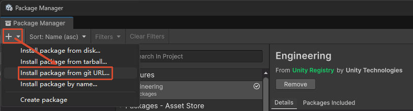
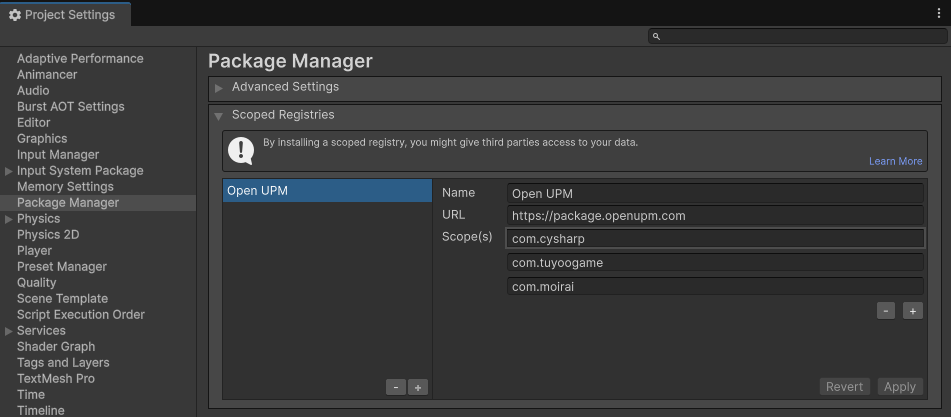
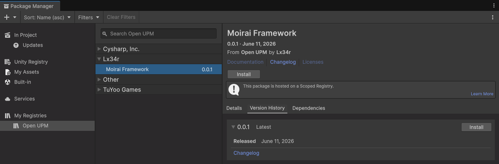

# 安装与运行

> 从环境要求到第一次跑起来：三种安装方式、初始设置与编辑器/打包运行流程。

---

## 环境要求

- **Unity 版本**: 2022.3.x（推荐）或更高
- **开发环境**: .NET 4.x
- **依赖插件**: [Odin Inspector and Serializer](https://assetstore.unity.com/packages/tools/utilities/odin-inspector-and-serializer-89041)
- **支持平台**: Windows、OSX、Android、iOS、WebGL、微信小游戏

---

## 下载安装

### 方式一：一键安装（推荐）

1. 通过以下任一方式安装 **Framework Installer**：

   - 在 **Window/Package Manager** 中，通过 Git URL 安装：

     ```bash
     https://github.com/TeamMoirai/com.moirai.framework.git#installer
     ```

     

   - 或克隆 `installer` 分支至工程目录（Assets/...）：

     ```bash
     git clone --branch installer --single-branch https://github.com/TeamMoirai/com.moirai.framework.git Scripts/Installer
     ```

2. 回到 Unity，手动执行菜单 `Tools/Install Framework`。

3. 安装完成后可安全删除该脚本。

### 方式二：UPM 安装

1. 在 **Project Settings/Package Manager** 中，手动添加 **Scoped Registry**：

   ```text
   // 输入以下内容（国际版）
   Name: Open UPM
   URL: https://package.openupm.com
   Scope(s): com.cysharp
             com.tuyoogame
             com.moirai
   ```

   

2. 在 **Window/Package Manager** 中，选中 **Moirai Framework**，点击 **Install** 进行安装：

   

3. <a id="manual-import"></a>手动复制 `工程根目录/Library/PackageCache/com.moirai.framework@xxx/Templates~/` 下 **@Requirements** 文件夹内的所有内容到 **工程根目录/Assets** 目录。

   （可选）根据需要选择同目录下合适的模板复制到工程，一般选择 **NormalTemplate** 即可。

### 方式三：手动安装

1. 以下获取框架的方式任选其一：

   - 在 **Window/Package Manager** 中，通过 Git URL 安装：

     ```bash
     https://github.com/TeamMoirai/com.moirai.framework.git
     ```

   - 在发布的 Release 版本中，选择最新版本下载 **Source Code** 压缩包。

2. 参见 **[方式二第 3 步](#manual-import)**，将 `Templates~/@Requirements` 内容复制进工程。

---

## 初始设置

### 场景打包

将 `Scenes/main.unity`（随模板复制进工程）加入打包列表：

- Unity 6.0+：`File -> Build Profiles -> Scene List`
- Unity 6.0-：`File -> Build Settings -> Scenes In Build`

### 配置表服务

- 在 `Tools/Framework Settings` 窗口选择 `[框架]Luban 配置`，点击 `生成 Config 到指定目录`。
- 初次生成时，导出前先执行 **build-luban** 编译（脚本位于模板 `Config/` 目录），或自行导入 Luban 至配置表根目录。
- 如果移动了配置表目录，需在 `Tools/Framework Settings` 的 `[框架]Luban 配置` 中手动更新——`重定向 Config 目录`。

---

## 运行

### 编辑器模式运行

在 `Tools/Framework Settings` 的 `[服务]资源设置` 中将 `PlayMode` 设为 `EditorSimulate`（编辑器下的模拟模式，默认值），点击 `Play` 开始运行。

### 打包运行（热更新流程）

1. 运行菜单 `HybridCLR/Install...` 安装 HybridCLR（HybridCLR 包菜单）
2. 运行菜单 `HybridCLR/Define Symbols/Enable HybridCLR` 开启热更新
3. 运行菜单 `HybridCLR/Generate/All` 进行必要的生成操作（HybridCLR 包菜单）
4. 运行菜单 `HybridCLR/Build/BuildAssets And CopyTo AssemblyTextAssetPath` 生成热更新 DLL
5. 运行菜单 `YooAsset/Bundle Builder` 构建 AssetBundle（YooAsset 包菜单）
6. 打开 Build Settings，点击 `Build And Run`

> 💡 **提示**: 遇到问题请查看 [HybridCLR 常见错误](https://hybridclr.doc.code-philosophy.com/docs/help/commonerrors)

完整启动链与各阶段的可配置项见 [Procedure 服务文档](Procedure.md)。

---
[« 返回文档索引](Index.md) · [主 README](../../README.md) · [English](../en/Install.md)
